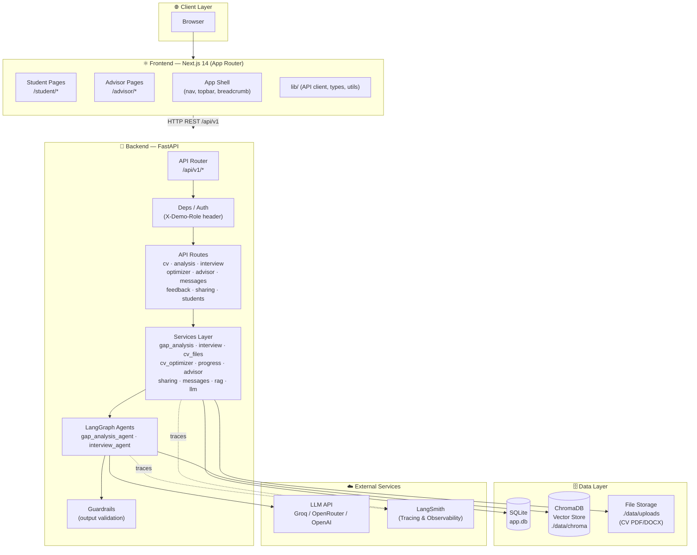
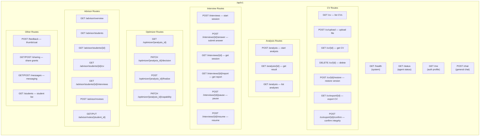
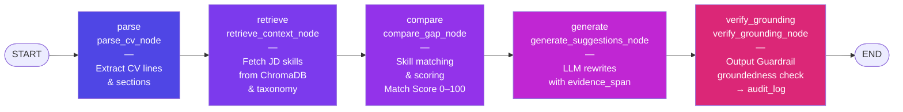
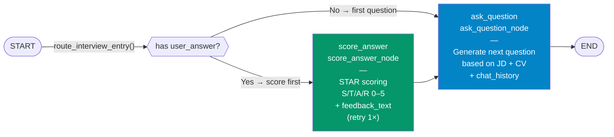
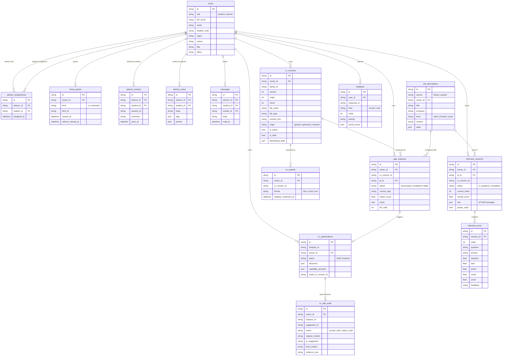
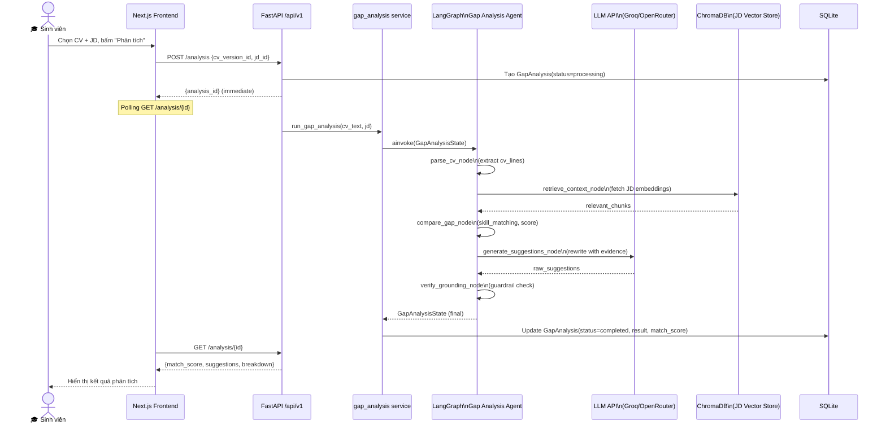
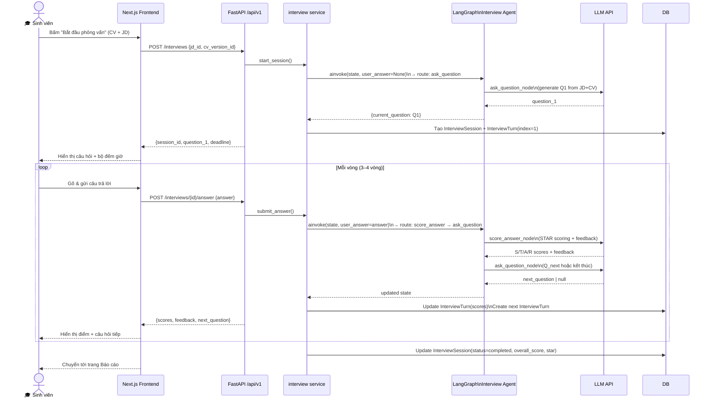
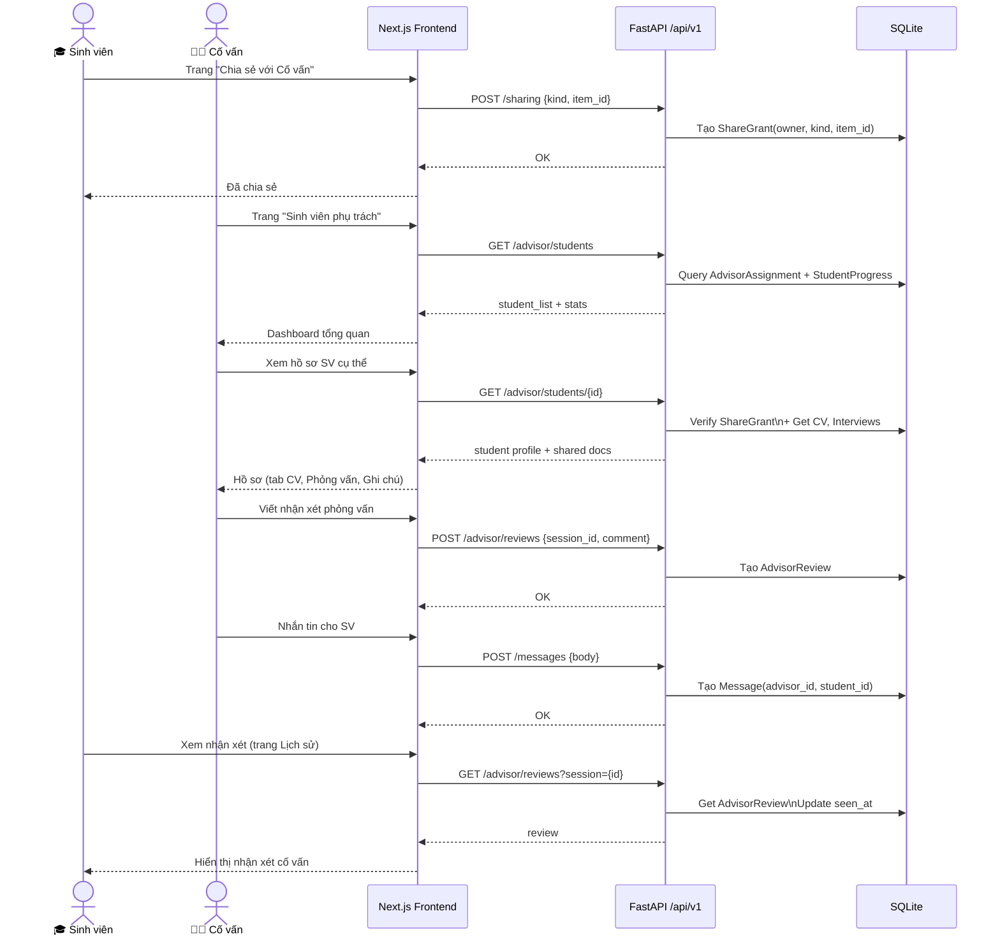
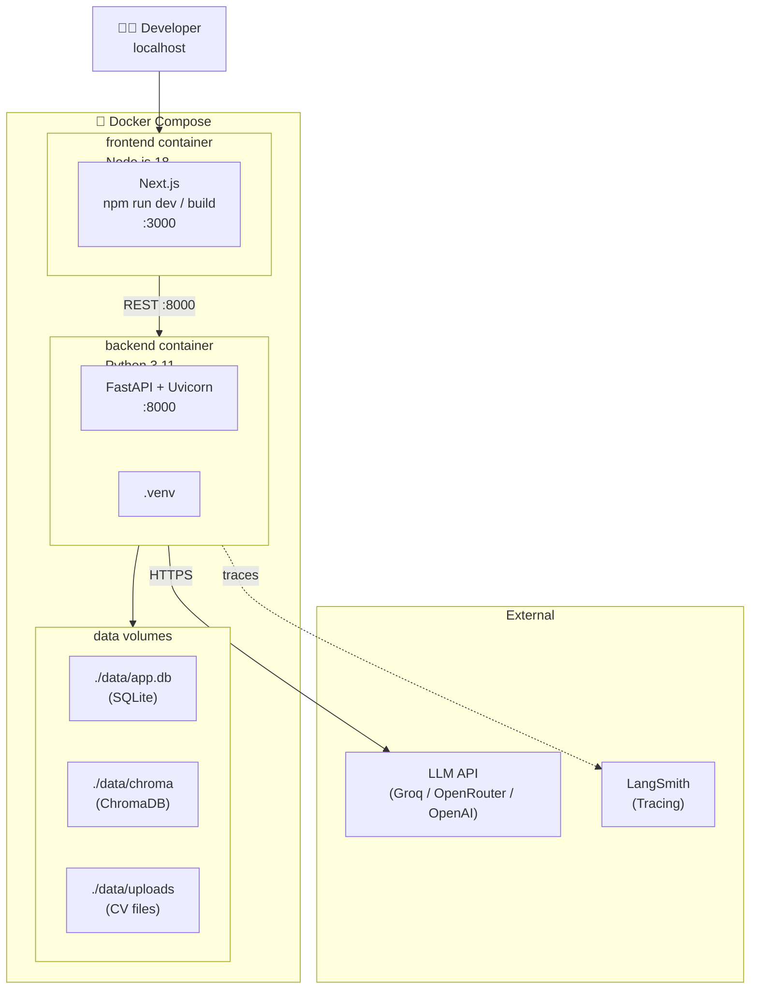

# P-131 — Trợ lý Nghề nghiệp X (EDU-17): Architecture Diagrams

> Được tạo tự động từ source code — cập nhật lần cuối: 2026-10-04

---

## 1. System Architecture (High-Level)

---

## 2. Frontend Component Tree

```mermaid
graph TD
    subgraph APP["app/ (Next.js App Router)"]
        ROOT_LAYOUT["layout.tsx\n(ThemeProvider, Fonts)"]
        ROOT_PAGE["page.tsx\n(role-based redirect)"]

        subgraph STUDENT_APP["app/student/"]
            S_WORKSPACE["(workspace)/\n(AppShell + StudentShell nav)"]
            S_FOCUS["(focus)/\n(no nav - interview session)"]
            S_OV["page.tsx — Tổng quan"]
            S_CV["cv/ — CV của tôi"]
            S_ANALYSIS["analysis/ — Phân tích CV & JD"]
            S_INTERVIEW["interview/ — Luyện phỏng vấn"]
            S_HISTORY["history/ — Lịch sử & Tiến bộ"]
            S_SHARE["share/ — Chia sẻ với Cố vấn"]
            S_SETTINGS["settings/ — Cài đặt"]
        end

        subgraph ADVISOR_APP["app/advisor/"]
            A_LAYOUT["layout.tsx (AdvisorShell nav)"]
            A_OV["page.tsx — Tổng quan"]
            A_STUDENTS["students/ — Sinh viên phụ trách"]
            A_PROFILE["students/[id]/ — Hồ sơ SV"]
        end
    end

    subgraph COMPONENTS["components/"]
        subgraph STUDENT_COMP["student/"]
            SC_OVERVIEW["overview/"]
            SC_CV["cv/\ncv-sections.tsx"]
            SC_ANALYSIS["analysis/\nanalysis-result.tsx\nanalysis-result-sections.tsx"]
            SC_INTERVIEW["interview/"]
            SC_HISTORY["history/\nstudent-history.tsx\nhistory-sections.tsx"]
            SC_OPTIMIZER["optimizer/\ncv-optimizer.tsx"]
            SC_SHARE["share/\nshare-with-advisor.tsx\nshare-sections.tsx"]
            SC_SETTINGS["settings/\nstudent-settings.tsx\nsettings-sections.tsx"]
        end

        subgraph ADVISOR_COMP["advisor/"]
            AC_OVERVIEW["overview/\nadvisor-overview.tsx"]
            AC_STUDENTS["students/\nstudent-list.tsx"]
            AC_PROFILE["profile/\nstudent-profile.tsx\nprofile-cv-tab.tsx\nprofile-interview-tab.tsx\nprofile-notes-tab.tsx"]
            AC_PROGRESS["progress-blocks.tsx"]
        end

        subgraph SHELL["shell/"]
            SH_APPSHELL["app-shell.tsx"]
            SH_NAV["nav-config.ts\n(studentShell, advisorShell)"]
        end

        subgraph COMMON["common/"]
            CM_PANEL["panel.tsx"]
            CM_HINT["hint-popover.tsx"]
        end

        CHAT["chat/\nchat-panel.tsx"]
        INTERVIEW_CHAT["InterviewChat.tsx"]
        FEEDBACK["FeedbackWidget.tsx"]
    end

    ROOT_LAYOUT --> STUDENT_APP
    ROOT_LAYOUT --> ADVISOR_APP
    S_WORKSPACE --> S_OV & S_CV & S_ANALYSIS & S_INTERVIEW & S_HISTORY & S_SHARE & S_SETTINGS
    S_FOCUS --> S_INTERVIEW
    A_LAYOUT --> A_OV & A_STUDENTS & A_PROFILE

    S_OV --> SC_OVERVIEW
    S_CV --> SC_CV
    S_ANALYSIS --> SC_ANALYSIS
    S_INTERVIEW --> SC_INTERVIEW
    S_HISTORY --> SC_HISTORY
    S_SHARE --> SC_SHARE
    S_SETTINGS --> SC_SETTINGS
    SC_ANALYSIS -->|after analysis| SC_OPTIMIZER

    A_OV --> AC_OVERVIEW
    A_STUDENTS --> AC_STUDENTS
    A_PROFILE --> AC_PROFILE

    SH_APPSHELL --> SH_NAV
    SH_APPSHELL --> CM_PANEL & CM_HINT
```

---

## 3. Backend API Routes Map

---

## 4. LangGraph Agent Flows

### 4a. Gap Analysis Agent

**State:** `cv_raw` · `jd_raw` → `cv_lines` · `requirements` → `assessments` · `match_score` → `suggestions` (with `evidence_span`) → `grounding_results` · `is_grounded`

### 4b. Mock Interview Agent (STAR Rubric)

**State:** `job_role` · `cv_summary` · `jd_context` · `current_round` / `total_rounds` (3–4) → `situation_score` · `task_score` · `action_score` · `result_score` · `feedback_text` · `next_question`

---

## 5. Database Schema (ERD)

---

## 6. Data Flow — 3 Core User Journeys

### 6a. Gap Analysis Flow (US-SV-02)

### 6b. Mock Interview Flow (US-SV-04)

### 6c. Advisor HITL Flow (US-ADV)

---

## 7. Deployment Architecture

---

## 8. Technology Stack Summary

| Layer | Technology | Purpose |
|---|---|---|
| **Frontend** | Next.js 14 (App Router) + TypeScript | Student & Advisor UI |
| **Styling** | Tailwind CSS + shadcn/ui | Component library |
| **Backend** | FastAPI + Python 3.11 | REST API, async |
| **ORM** | SQLAlchemy 2.0 + Alembic | DB models & migrations |
| **Database** | SQLite (`./data/app.db`) | Persistence |
| **Vector Store** | ChromaDB (`./data/chroma`) | JD embeddings for RAG |
| **AI Orchestration** | LangGraph (StateGraph) | Agent workflows |
| **LLM** | Groq / OpenRouter / OpenAI | Text generation |
| **LLM Client** | `langchain-openai` (ChatOpenAI) | Unified LLM interface |
| **Observability** | LangSmith | AI call tracing |
| **Auth** | `X-Demo-Role` header | Demo-mode role switching |
| **Containerization** | Docker + Docker Compose | Deployment |
| **Validation** | Pydantic v2 | Schema & settings |
| **Config** | `pydantic-settings` + `.env` | Environment management |
