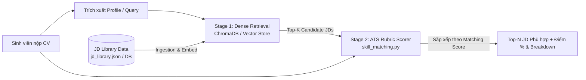

Để thực hiện nhiệm vụ **(A3) Gợi ý JD phù hợp từ CV (Retrieval Top-N JD + Matching Score từng JD)**, kiến trúc chuẩn và tối ưu nhất cho repository hiện tại của bạn là mô hình **Two-Stage Retrieval & Scoring Pipeline**:



Dưới đây là thiết kế chi tiết và từng bước triển khai Document Store từ dữ liệu JD có sẵn trong dự án.

---

### 1. Phân tích dữ liệu & Chiến lược Document Modeling

Trong dự án của bạn:
- Nguồn dữ liệu JD: [`src/db/fixtures/jd_library.json`](file:///d:/DATA/IT/AIA/P-131/src/db/fixtures/jd_library.json) và bảng SQLAlchemy [`JobDescription`](file:///d:/DATA/IT/AIA/P-131/src/db/models.py#L162-L180).
- Mỗi JD đã có metadata rất phong phú: `id`, `title`, `company`, `industry`, `level`, `content`, và mảng `skills` được phân loại:
  - `required` (trọng số $w=3$)
  - `preferred` (trọng số $w=2$)
  - `additional` (trọng số $w=1$)

#### Nguyên tắc Chunking & Embedding Representation:
1. **Không cắt nhỏ (No splitting/chunking)**: Mỗi JD trong thư viện có độ dài khoảng 300–600 từ. Khi gợi ý việc làm từ CV, ta cần tìm mức độ phù hợp của **toàn bộ vị trí**, vì vậy **1 JD = 1 Document** trong Vector Store.
2. **Enriched Text Representation (Tạo văn bản nhúng giàu ngữ nghĩa)**:
   Nếu chỉ embed `content` thô, embedding model có thể bị phân tán bởi các câu chào hỏi, quyền lợi. Thay vào đó, hãy tổng hợp một chuỗi text tối ưu hóa cho semantic search:

```python
enriched_text = f"""Vị trí: {title} | Ngành nghề: {industry} | Cấp bậc: {level}
Kỹ năng bắt buộc (Required): {', '.join(required_skills)}
Kỹ năng ưu tiên (Preferred): {', '.join(preferred_skills)}
Mô tả công việc & Yêu cầu:
{content}"""
```

3. **Metadata Payload**:
   Lưu vào Vector Store các thông tin cần thiết:
   `{"jd_id": "...", "title": "...", "company": "...", "industry": "...", "level": "..."}`.

---

### 2. Thiết lập Vector Document Store (`src/services/jd_store.py`)

Cấu hình dự án của bạn trong [`src/config.py`](file:///d:/DATA/IT/AIA/P-131/src/config.py#L66) đã có sẵn `chroma_persist_dir: str = "./data/chroma"`. Ta sẽ dùng **ChromaDB** (hoặc Qdrant) kết hợp với LangChain Embeddings.

Tạo file mới [`src/services/jd_store.py`](file:///d:/DATA/IT/AIA/P-131/src/services/jd_store.py):

```python
"""Quản lý Vector Document Store cho dữ liệu Job Description (JD)."""

import json
from pathlib import Path
from typing import Any

from langchain_core.documents import Document
from langchain_openai import OpenAIEmbeddings

from src.config import get_settings


class JDDocumentStore:
    def __init__(self, collection_name: str = "jd_collection"):
        self.settings = get_settings()
        self.collection_name = collection_name
        self.persist_dir = self.settings.chroma_persist_dir

        # Khởi tạo embedding model tương thích với OpenAI API / OpenRouter
        api_key, base_url = self.settings.get_llm_credentials()
        self.embeddings = OpenAIEmbeddings(
            model="text-embedding-3-small",  # Hoặc embedding model tương thích
            api_key=api_key or "sk-dummy",
            base_url=base_url if "openai.com" in (base_url or "") else None,
        )
        self._vector_store = None

    def _get_vector_store(self):
        """Lazy load Chroma vector store."""
        if self._vector_store is None:
            from langchain_chroma import Chroma

            self._vector_store = Chroma(
                collection_name=self.collection_name,
                embedding_function=self.embeddings,
                persist_directory=self.persist_dir,
            )
        return self._vector_store

    def build_jd_document(self, jd_item: dict[str, Any]) -> Document:
        """Đóng gói 1 JD thành Document chuẩn kèm enriched text và metadata."""
        skills = jd_item.get("skills", [])
        req_skills = [s["name"] for s in skills if s.get("importance") == "required"]
        pref_skills = [s["name"] for s in skills if s.get("importance") == "preferred"]

        page_content = (
            f"Vị trí: {jd_item.get('title', '')} | Cấp bậc: {jd_item.get('level', '')} | Ngành: {jd_item.get('industry', '')}\n"
            f"Kỹ năng cốt lõi: {', '.join(req_skills)}\n"
            f"Kỹ năng ưu tiên: {', '.join(pref_skills)}\n"
            f"Chi tiết công việc và yêu cầu:\n{jd_item.get('content', '')}"
        )

        metadata = {
            "jd_id": jd_item["id"],
            "title": jd_item.get("title", ""),
            "company": jd_item.get("company", ""),
            "industry": jd_item.get("industry", ""),
            "level": jd_item.get("level", ""),
        }
        return Document(page_content=page_content, metadata=metadata)

    def index_from_fixtures(self, fixture_path: str = "src/db/fixtures/jd_library.json") -> int:
        """Nạp và index toàn bộ JD từ file fixture vào Vector Store."""
        path = Path(fixture_path)
        if not path.exists():
            raise FileNotFoundError(f"Không tìm thấy fixture tại: {fixture_path}")

        with open(path, encoding="utf-8") as f:
            jds: list[dict[str, Any]] = json.load(f)

        docs = [self.build_jd_document(item) for item in jds]
        ids = [item["id"] for item in jds]

        store = self._get_vector_store()
        # Thêm documents với ID cố định để tránh duplicate khi re-index
        store.add_documents(documents=docs, ids=ids)
        return len(docs)

    def search_candidates(self, query_text: str, top_k: int = 6) -> list[tuple[Document, float]]:
        """Truy xuất Top-K JD ứng viên dựa trên độ tương đồng ngữ nghĩa."""
        store = self._get_vector_store()
        # similarity_search_with_relevance_scores trả về (Document, score)
        return store.similarity_search_with_relevance_scores(query_text, k=top_k)


_jd_store_instance: JDDocumentStore | None = None


def get_jd_store() -> JDDocumentStore:
    global _jd_store_instance
    if _jd_store_instance is None:
        _jd_store_instance = JDDocumentStore()
    return _jd_store_instance
```

---

### 3. Pipeline Gợi ý: Retrieval + ATS Matching Score

Để giải quyết yêu cầu bài toán: **Từ CV -> Trả Top-N JD + Matching Score từng JD**:

1. **Query Generation từ CV**:
   Không nên ném nguyên một CV dài 1000 từ vào vector search vì dễ gây loãng ngữ cảnh. Thay vào đó, lấy:
   - Các kỹ năng chính (`skills`), mục tiêu nghề nghiệp, và tóm tắt các dự án/kinh nghiệm trong CV làm `query_text`.
2. **Stage 1 (Retrieval)**: Truy xuất `top_k=6` candidate JDs từ `JDDocumentStore`.
3. **Stage 2 (Scoring & Ranking)**:
   Dự án của bạn đã có module tính điểm cực kỳ hoàn chỉnh theo PRD 5.2 tại [`src/services/skill_matching.py`](file:///d:/DATA/IT/AIA/P-131/src/services/skill_matching.py):
   - [`split_cv_lines(cv_text)`](file:///d:/DATA/IT/AIA/P-131/src/services/skill_matching.py#L77-L100): Phân tích CV thành các dòng có gắn Section (Experience, Projects, Skills...).
   - [`assess_by_rules(req, lines)`](file:///d:/DATA/IT/AIA/P-131/src/services/skill_matching.py#L175-L202): Chấm điểm từng yêu cầu (Match = 1.0 nếu có bằng chứng, 0.5 nếu chỉ liệt kê, 0.0 nếu thiếu).
   - [`compute_score(assessments)`](file:///d:/DATA/IT/AIA/P-131/src/services/skill_matching.py#L207-L231): Tính điểm $Score = \frac{\sum (w_i \times Match_i)}{\sum w_i} \times 100\%$.

Tạo hàm xử lý pipeline tại [`src/services/jd_recommendation.py`](file:///d:/DATA/IT/AIA/P-131/src/services/jd_recommendation.py):

```python
"""Service gợi ý JD phù hợp từ CV (Task A3)."""

from typing import Any
from sqlalchemy.orm import Session
from sqlalchemy import select

from src.db.models import JobDescription
from src.services.jd_store import get_jd_store
from src.services.skill_matching import split_cv_lines, assess_by_rules, compute_score, match_label


def recommend_top_jds_from_cv(
    cv_text: str,
    db: Session,
    top_n: int = 3,
    candidate_pool_size: int = 6,
) -> list[dict[str, Any]]:
    """
    1. Retrieval: Tìm candidate_pool_size JD gần nhất qua Vector Store.
    2. Scoring: Chấm CV–JD Matching Score chuẩn PRD 5.2 cho từng JD.
    3. Re-ranking: Trả về Top-N JD có Matching Score cao nhất.
    """
    cv_lines = split_cv_lines(cv_text)
    jd_store = get_jd_store()

    # Tạo query ngắn gọn từ 300 từ đầu và các dòng kỹ năng của CV
    query_text = " ".join([line["text"] for line in cv_lines if line["section"] in {"skills", "experience", "projects"}][:50])
    if not query_text:
        query_text = cv_text[:500]

    # Stage 1: Dense Retrieval
    candidates = jd_store.search_candidates(query_text=query_text, top_k=candidate_pool_size)

    # Lấy thông tin chi tiết các JD từ database (để có danh sách skills chuẩn)
    jd_ids = [doc.metadata["jd_id"] for doc, _ in candidates]
    db_jds = {jd.id: jd for jd in db.scalars(select(JobDescription).where(JobDescription.id.in_(jd_ids)))}

    scored_jds = []
    for doc, sim_score in candidates:
        jd_id = doc.metadata["jd_id"]
        jd_obj = db_jds.get(jd_id)
        if not jd_obj:
            continue

        # Stage 2: Tính Matching Score theo rubric PRD 5.2
        requirements = jd_obj.skills or []
        assessments = [assess_by_rules(req, cv_lines) for req in requirements]
        match_score, breakdown = compute_score(assessments)

        scored_jds.append({
            "jd_id": jd_id,
            "title": jd_obj.title,
            "company": jd_obj.company,
            "industry": jd_obj.industry,
            "level": jd_obj.level,
            "semantic_score": round(float(sim_score), 3),
            "match_score": match_score,
            "match_label": match_label(match_score),
            "matched_skills": [a["skill"] for a in assessments if a["status"] == "matched"],
            "missing_skills": [a["skill"] for a in assessments if a["status"] == "missing"],
            "breakdown": breakdown,
        })

    # Sắp xếp ưu tiên theo Matching Score (%) giảm dần, nếu bằng điểm thì so sánh semantic_score
    scored_jds.sort(key=lambda x: (x["match_score"] or 0, x["semantic_score"]), reverse=True)

    return scored_jds[:top_n]
```

---

### 4. Tích hợp Script Indexing & API Endpoint

#### 4.1 Script tự động nạp dữ liệu JD khi khởi động server
Bạn có thể gọi hàm indexing trong file seed [`src/db/seed.py`](file:///d:/DATA/IT/AIA/P-131/src/db/seed.py) hoặc `lifespan` của FastAPI trong [`src/main.py`](file:///d:/DATA/IT/AIA/P-131/src/main.py):

```python
# Trong src/main.py lifespan hoặc scripts/seed_vector_store.py
from src.services.jd_store import get_jd_store

def seed_vector_store():
    store = get_jd_store()
    count = store.index_from_fixtures()
    print(f"✅ Đã index {count} JD vào ChromaDB document store.")
```

#### 4.2 Thêm Route API vào [`src/api/analysis.py`](file:///d:/DATA/IT/AIA/P-131/src/api/analysis.py)

```python
@router.post("/jd/recommend", tags=["Gap Analysis"])
def recommend_jds(
    cv_version_id: str,
    user: CurrentStudent,
    db: DbSession,
    top_n: int = 3,
):
    """(Task A3) Gợi ý Top-N JD phù hợp nhất với CV đã chọn kèm Matching Score từng JD."""
    cv = db.get(CvVersion, cv_version_id)
    if cv is None or cv.owner_id != user.id:
        raise AppError(404, "Không tìm thấy CV.", "cv_not_found")

    results = recommend_top_jds_from_cv(
        cv_text=cv.content_text,
        db=db,
        top_n=top_n,
    )
    return {"cv_version_id": cv_version_id, "recommendations": results}
```

---

### 5. Đánh giá chất lượng Retrieval (Deliverable & Benchmark)

Trong repo của bạn đã có sẵn công cụ tính toán metric tại [`src/services/benchmark.py`](file:///d:/DATA/IT/AIA/P-131/src/services/benchmark.py):
- `calculate_recall_at_k`
- `calculate_precision_at_k`
- `calculate_ndcg_at_k`

Bạn có thể tạo một file test benchmark `tests/test_retrieval_benchmark.py`:
- Chuẩn bị 3–5 CV mẫu của các ngành (Backend Python, Data Analyst, Marketing, XNK).
- Chạy qua pipeline retrieval và so sánh danh sách `retrieved` với `ground_truth` (vị trí công việc thực tế của CV).
- Ghi kết quả vào [`eval/results/report.md`](file:///d:/DATA/IT/AIA/P-131/eval/results/report.md) để nộp tiêu chí đánh giá RAG/Retrieval của BTC.