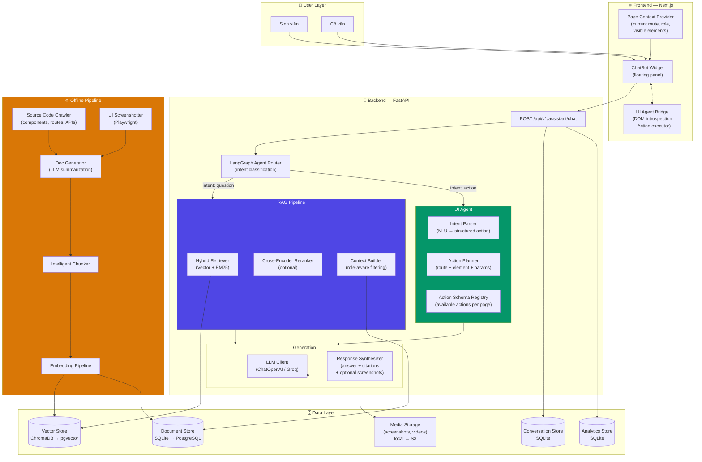
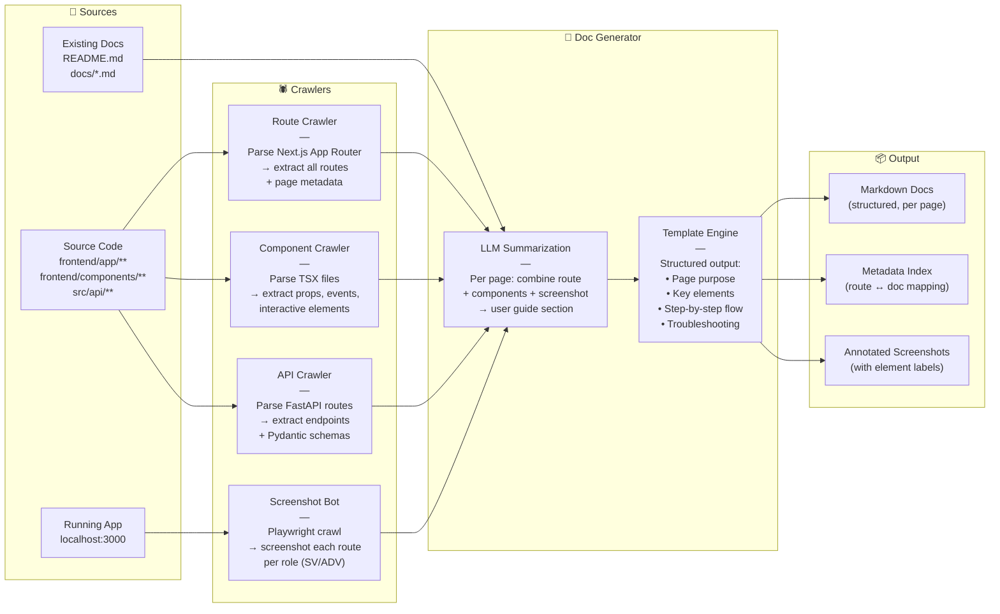
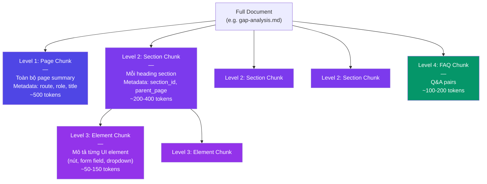
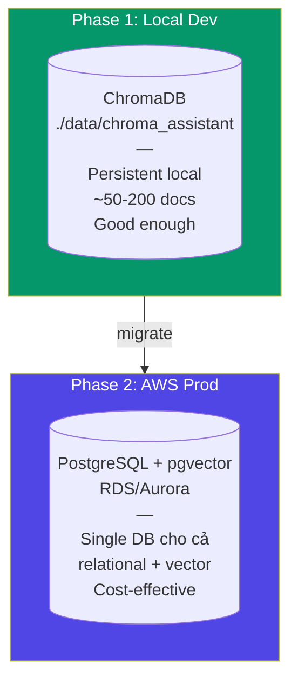
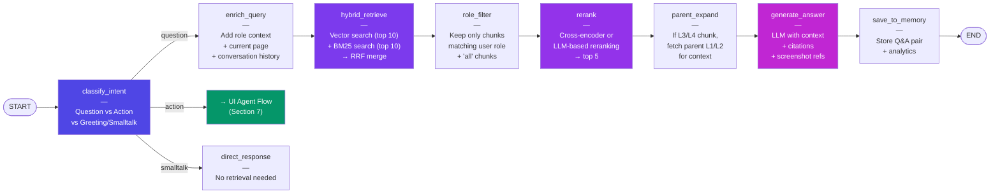
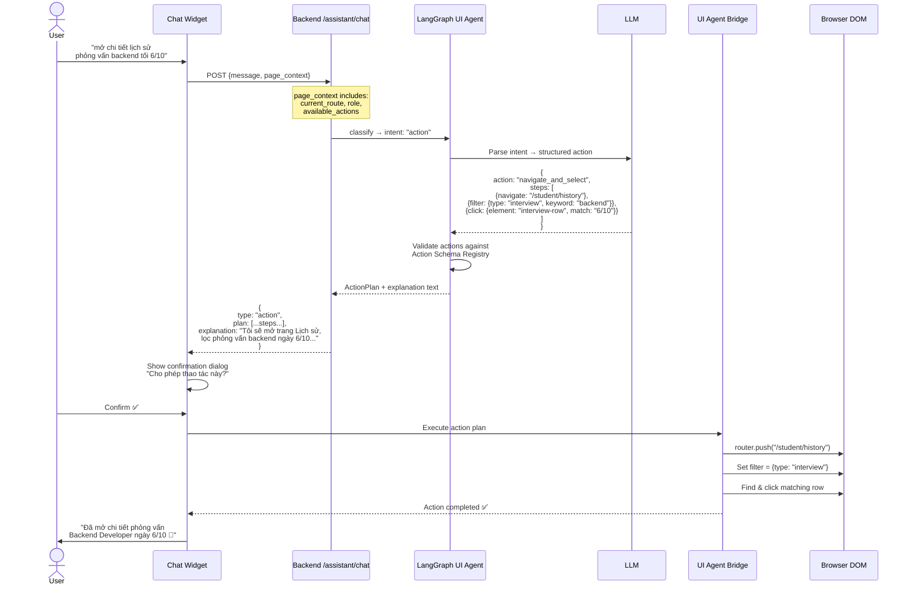
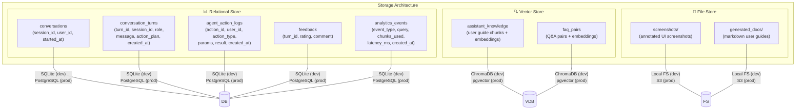
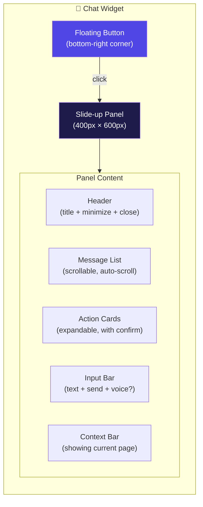
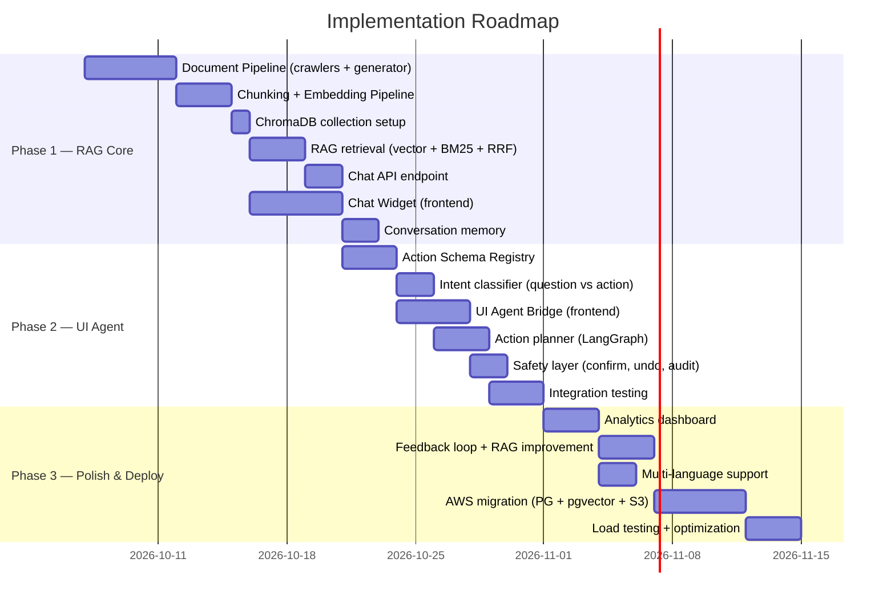

# 🏗️ Kiến trúc RAG Chatbot + UI Agent — Trợ lý Nghề nghiệp X (P-131)

> **Feature:** Chatbot hỏi-đáp hướng dẫn sử dụng + Agent thao tác trực tiếp trên UI  
> **Scope:** Cả Sinh viên & Cố vấn, context-aware theo role  
> **Agent Level:** Full automation (navigate, highlight, click, fill form, submit)  
> **Constraints:** Open-source first, self-hosted → migrate AWS khi cần

---

## Mục lục

- [1. Tổng quan kiến trúc](#1-tổng-quan-kiến-trúc)
- [2. Document Pipeline — Auto-generate Knowledge Base](#2-document-pipeline)
- [3. Chunking Strategy](#3-chunking-strategy)
- [4. Embedding Model](#4-embedding-model)
- [5. Vector Store Architecture](#5-vector-store-architecture)
- [6. RAG Retrieval Pipeline](#6-rag-retrieval-pipeline)
- [7. UI Agent Architecture](#7-ui-agent-architecture)
- [8. Storage Architecture](#8-storage-architecture)
- [9. Frontend Integration](#9-frontend-integration)
- [10. Phasing & Migration Path](#10-phasing--migration-path)

---

## 1. Tổng quan kiến trúc



### Lý do kiến trúc này phù hợp

| Quyết định | Lý do |
|---|---|
| **Tách RAG vs UI Agent thành 2 nhánh** | Intent khác nhau hoàn toàn: hỏi đáp cần retrieval → generation, thao tác cần NLU → action planning. Router phân loại trước giúp giảm latency và tăng accuracy |
| **LangGraph Agent Router** | Tận dụng LangGraph đã có trong project, consistent với gap_analysis agent và interview agent |
| **Hybrid Retriever (Vector + BM25)** | Vector search giỏi semantic similarity nhưng kém exact match (tên nút, tên route). BM25 bù đắp bằng keyword matching. Kết hợp = tốt nhất cho domain-specific Q&A |
| **UI Agent Bridge ở Frontend** | Agent backend không thể trực tiếp thao tác DOM. Bridge pattern: backend trả structured action → frontend execute. An toàn hơn so với cho backend remote control browser |
| **Offline Pipeline tách biệt** | Tránh bottleneck real-time. Document indexing nặng (screenshot, LLM summarization) chạy async, không ảnh hưởng user experience |

---

## 2. Document Pipeline — Auto-generate Knowledge Base {#2-document-pipeline}

Bạn muốn **auto-generate từ source code + UI screenshots**, đây là pipeline chi tiết:



### Crawler chi tiết

| Crawler | Input | Output | Tool |
|---|---|---|---|
| **Route Crawler** | `frontend/app/**/page.tsx` | Route map: path, layout group, params | AST parser (ts-morph / custom regex) |
| **Component Crawler** | `frontend/components/**/*.tsx` | Component registry: name, props, interactive elements (buttons, forms, links) | ts-morph / react-docgen-typescript |
| **API Crawler** | `src/api/**/*.py` + Swagger `/docs` | Endpoint catalog: method, path, params, response schema | FastAPI OpenAPI schema (`/openapi.json`) |
| **Screenshot Bot** | Running app (localhost:3000) | Per-route screenshots, 2 variants (student role, advisor role) | Playwright + `X-Demo-Role` header |

### Generated Document Structure

```
docs/user-guide/
├── _meta.json                    # Route ↔ doc mapping
├── student/
│   ├── overview.md               # Trang tổng quan SV
│   ├── cv-management.md          # Upload, xem, xoá CV
│   ├── gap-analysis.md           # Phân tích khoảng cách CV-JD
│   ├── cv-optimizer.md           # Tối ưu CV
│   ├── mock-interview.md         # Luyện phỏng vấn STAR
│   ├── history.md                # Lịch sử & Tiến bộ
│   ├── share-with-advisor.md     # Chia sẻ với cố vấn
│   └── settings.md               # Cài đặt
├── advisor/
│   ├── dashboard.md              # Tổng quan cố vấn
│   ├── student-list.md           # Danh sách SV
│   └── student-profile.md        # Hồ sơ chi tiết SV
├── common/
│   ├── navigation.md             # Điều hướng chung
│   ├── chat.md                   # Tính năng chat
│   └── faq.md                    # Câu hỏi thường gặp
└── screenshots/
    ├── student/                  # Screenshots per page
    └── advisor/
```

---

## 3. Chunking Strategy {#3-chunking-strategy}

### Chiến lược: **Hierarchical Semantic Chunking**



### Chi tiết chunking

| Level | Nội dung | Chunk size | Overlap | Metadata enrichment |
|---|---|---|---|---|
| **L1 — Page** | Summary toàn trang + purpose | 400-600 tokens | 0 | `route`, `role`, `title`, `screenshot_path` |
| **L2 — Section** | Heading + content block (steps, descriptions) | 200-400 tokens | 50 tokens | `section_id`, `parent_page`, `heading` |
| **L3 — Element** | Mô tả UI element (vị trí, chức năng, cách dùng) | 50-150 tokens | 0 | `element_type`, `element_id`, `css_selector`, `page_route` |
| **L4 — FAQ** | Question-Answer pairs | 100-200 tokens | 0 | `question`, `category`, `related_pages` |

### Lý do chọn Hierarchical Chunking

> [!IMPORTANT]
> **Tại sao không dùng fixed-size chunking?**
> - User guide có cấu trúc rõ ràng (page → section → element). Fixed-size sẽ cắt ngang logic, mất context.
> - Hierarchical cho phép retrieval ở nhiều granularity: hỏi tổng quan → trả L1, hỏi cụ thể nút → trả L3.
> - Metadata enrichment ở mỗi level giúp filter theo role, route → tăng precision đáng kể.

### Parent-Child Linking

```python
# Mỗi chunk có parent_id để reconstruct context khi cần
chunk_schema = {
    "chunk_id": "student/gap-analysis#step-3-view-results",
    "parent_id": "student/gap-analysis",       # → có thể fetch parent chunk để bổ sung context
    "level": 2,
    "content": "Sau khi phân tích hoàn tất, kết quả hiển thị gồm...",
    "metadata": {
        "route": "/student/analysis",
        "role": "student",
        "section": "Xem kết quả phân tích",
        "related_elements": ["match-score-badge", "skill-gap-table", "suggestion-list"],
        "screenshot": "screenshots/student/analysis-result.png"
    }
}
```

---

## 4. Embedding Model {#4-embedding-model}

### Lựa chọn: **`sentence-transformers/multilingual-e5-large`** (Primary) + **fallback Gemini Embedding**

| Tiêu chí | multilingual-e5-large | OpenAI text-embedding-3-small | Gemini text-embedding-004 |
|---|---|---|---|
| **Vietnamese support** | ✅ Excellent (trained on CC100-vi) | ⚠️ Good but not optimized | ✅ Very good |
| **Cost** | 🟢 Free (self-hosted) | 🔴 $0.02/1M tokens | 🟡 Free tier limited |
| **Dimension** | 1024 | 1536 | 768 |
| **Self-hosted** | ✅ Yes (HuggingFace) | ❌ API only | ❌ API only |
| **Latency (local)** | ~50ms/query | ~200ms/query (network) | ~150ms/query (network) |
| **MTEB-vi rank** | Top 5 | Top 10 | Top 3 |

### Lý do chọn

> [!TIP]
> **`multilingual-e5-large`** là lựa chọn tối ưu vì:
> 1. **Free, self-hosted** — phù hợp constraint tối ưu chi phí
> 2. **Multilingual xuất sắc** — trained trên 100+ languages bao gồm Vietnamese
> 3. **1024 dimensions** — balance giữa quality và storage
> 4. **Instruction-aware** — support prefix `query:` và `passage:` để phân biệt query vs document, tăng recall
> 5. **Chạy được trên CPU** — không cần GPU cho inference (important cho dev local)

### Cấu hình embedding

```python
# config
EMBEDDING_CONFIG = {
    "model_name": "intfloat/multilingual-e5-large",
    "device": "cpu",                    # hoặc "cuda" nếu có GPU
    "batch_size": 32,                   # batch indexing
    "query_prefix": "query: ",          # E5 instruction prefix
    "passage_prefix": "passage: ",
    "normalize": True,
    "dimension": 1024,
    # Fallback cho cloud deployment
    "fallback_provider": "gemini",      # text-embedding-004
    "fallback_api_key_env": "GEMINI_EMBEDDING_KEY",
}
```

### Migration path sang AWS

```
Local (dev):     multilingual-e5-large on CPU (~50ms/query)
     ↓
AWS (prod):      Option A: Same model trên EC2 g5.xlarge (GPU) → ~5ms/query
                 Option B: Amazon Titan Embeddings v2 (managed, $0.02/1M tokens)
                 Option C: Gemini text-embedding-004 (cross-cloud, free tier)
```

---

## 5. Vector Store Architecture {#5-vector-store-architecture}

### Phase 1 (Dev): ChromaDB — Phase 2 (Prod): pgvector



### Tại sao ChromaDB → pgvector, không phải Pinecone/Weaviate?

| Factor | ChromaDB (Phase 1) | pgvector (Phase 2) | Pinecone/Weaviate |
|---|---|---|---|
| **Cost** | 🟢 Free | 🟢 Included with PostgreSQL | 🔴 Paid ($70+/mo) |
| **Self-hosted** | ✅ | ✅ | ⚠️ Weaviate yes, Pinecone no |
| **Already in stack** | ✅ (đang dùng cho JD) | ✅ (SQLite → PG là migration tự nhiên) | ❌ Thêm dependency mới |
| **Hybrid search** | ⚠️ Limited | ✅ (SQL + vector cùng query) | ✅ |
| **Scale 50-200 docs** | ✅ Perfect | ✅ Overkill but future-proof | 🔴 Overkill |
| **Operational burden** | 🟢 Zero | 🟡 Manage PG | 🟡-🔴 |

> [!NOTE]
> **ChromaDB đủ tốt cho Phase 1** với quy mô 50-200 trang docs. Khi deploy AWS, migrate sang pgvector vì:
> 1. SQLite → PostgreSQL là migration path tự nhiên cho relational data
> 2. pgvector nằm cùng PostgreSQL → **1 database, 0 extra infra** cho cả relational + vector
> 3. AWS RDS PostgreSQL có pgvector extension built-in

### Collection Schema (ChromaDB / pgvector table)

```python
# ChromaDB collection cho Phase 1
assistant_docs_collection = {
    "name": "assistant_knowledge",
    "metadata": {"hnsw:space": "cosine"},
    "schema": {
        "id": str,              # "student/gap-analysis#step-3"
        "embedding": list[float],  # 1024-dim
        "document": str,        # chunk content
        "metadata": {
            "level": int,       # 1-4 (page, section, element, faq)
            "route": str,       # "/student/analysis"
            "role": str,        # "student" | "advisor" | "all"
            "page_title": str,
            "section": str,
            "parent_id": str,
            "element_ids": list[str],
            "screenshot_path": str,
            "updated_at": str,  # ISO timestamp
            "source": str,      # "auto-generated" | "manual"
            "language": str,    # "vi" | "en"
        }
    }
}
```

```sql
-- pgvector table cho Phase 2
CREATE TABLE assistant_chunks (
    id              TEXT PRIMARY KEY,
    content         TEXT NOT NULL,
    embedding       vector(1024),
    level           SMALLINT NOT NULL,          -- 1-4
    route           TEXT,
    role            TEXT DEFAULT 'all',         -- student | advisor | all
    page_title      TEXT,
    section_heading TEXT,
    parent_id       TEXT REFERENCES assistant_chunks(id),
    element_ids     TEXT[],
    screenshot_path TEXT,
    source          TEXT DEFAULT 'auto-generated',
    language        TEXT DEFAULT 'vi',
    created_at      TIMESTAMPTZ DEFAULT NOW(),
    updated_at      TIMESTAMPTZ DEFAULT NOW(),

    -- BM25 search support
    content_tsv     tsvector GENERATED ALWAYS AS (
        to_tsvector('simple', content)
    ) STORED
);

CREATE INDEX idx_chunks_embedding ON assistant_chunks
    USING ivfflat (embedding vector_cosine_ops) WITH (lists = 20);
CREATE INDEX idx_chunks_role ON assistant_chunks(role);
CREATE INDEX idx_chunks_route ON assistant_chunks(route);
CREATE INDEX idx_chunks_bm25 ON assistant_chunks USING gin(content_tsv);
```

---

## 6. RAG Retrieval Pipeline {#6-rag-retrieval-pipeline}

### LangGraph Agent Flow



### Hybrid Retrieval: Vector + BM25 + RRF

```python
# Reciprocal Rank Fusion (RRF) — kết hợp 2 retriever
def reciprocal_rank_fusion(
    vector_results: list[str],
    bm25_results: list[str],
    k: int = 60  # RRF constant
) -> list[tuple[str, float]]:
    """
    RRF score = Σ 1/(k + rank_i)
    
    Ví dụ: chunk xuất hiện rank 1 trong vector, rank 3 trong BM25:
    → score = 1/(60+1) + 1/(60+3) = 0.0164 + 0.0159 = 0.0323
    """
    scores = {}
    for rank, doc_id in enumerate(vector_results):
        scores[doc_id] = scores.get(doc_id, 0) + 1 / (k + rank + 1)
    for rank, doc_id in enumerate(bm25_results):
        scores[doc_id] = scores.get(doc_id, 0) + 1 / (k + rank + 1)
    
    return sorted(scores.items(), key=lambda x: x[1], reverse=True)
```

### Role-Aware Filtering

```python
def role_filter(chunks: list[Chunk], user_role: str) -> list[Chunk]:
    """
    Filter chunks theo role:
    - student chỉ thấy chunks role='student' hoặc 'all'
    - advisor chỉ thấy chunks role='advisor' hoặc 'all'
    
    → Tránh leak thông tin advisor-only cho student
    """
    return [c for c in chunks if c.metadata["role"] in (user_role, "all")]
```

### Generation Prompt Template

```
Bạn là trợ lý hướng dẫn sử dụng app "Trợ lý Nghề nghiệp X".
Vai trò hiện tại của người dùng: {role}
Trang hiện tại: {current_route}

Dựa trên các tài liệu tham khảo sau:
{retrieved_context}

Trả lời câu hỏi của người dùng. Quy tắc:
1. Chỉ trả lời dựa trên tài liệu được cung cấp. Nếu không tìm thấy, nói rõ.
2. Nếu có screenshot liên quan, đính kèm link screenshot.
3. Nếu câu hỏi liên quan đến thao tác, mô tả step-by-step.
4. Trích dẫn nguồn: [Tên trang](route).
5. Trả lời bằng {language}.
6. Nếu user hỏi về tính năng của role khác, giải thích nhưng lưu ý quyền truy cập.

Lịch sử hội thoại:
{conversation_history}

Câu hỏi: {user_question}
```

---

## 7. UI Agent Architecture {#7-ui-agent-architecture}

> Đây là phần phức tạp nhất — cho phép agent **thực sự thao tác** trên UI thay user.

### Kiến trúc: Backend → Structured Action → Frontend Execute



### Action Schema Registry

Mỗi page đăng ký các actions khả dụng:

```typescript
// frontend/lib/agent-actions/registry.ts

export interface AgentAction {
  id: string;
  description: string;           // Mô tả cho LLM hiểu
  route: string;                 // Route chứa action
  roles: ("student" | "advisor")[];
  params: Record<string, {
    type: "string" | "number" | "date" | "enum";
    description: string;
    required: boolean;
    enum_values?: string[];
  }>;
  execute: (params: Record<string, any>) => Promise<ActionResult>;
}

// Ví dụ actions cho student
export const studentActions: AgentAction[] = [
  {
    id: "navigate_to_page",
    description: "Chuyển đến một trang cụ thể trong ứng dụng",
    route: "*",
    roles: ["student", "advisor"],
    params: {
      target_route: {
        type: "enum",
        description: "Route đích",
        required: true,
        enum_values: [
          "/student", "/student/cv", "/student/analysis",
          "/student/interview", "/student/history",
          "/student/share", "/student/settings",
        ],
      },
    },
    execute: async ({ target_route }) => {
      router.push(target_route);
      return { success: true };
    },
  },
  {
    id: "view_interview_detail",
    description: "Xem chi tiết một buổi phỏng vấn cụ thể. Có thể tìm theo tên vị trí, ngày, hoặc điểm số.",
    route: "/student/history",
    roles: ["student"],
    params: {
      keyword: { type: "string", description: "Từ khoá tìm kiếm (vị trí, tên JD)", required: false },
      date: { type: "date", description: "Ngày phỏng vấn (YYYY-MM-DD)", required: false },
      session_id: { type: "string", description: "ID buổi phỏng vấn nếu biết", required: false },
    },
    execute: async ({ keyword, date, session_id }) => {
      // 1. Navigate to history page if not there
      // 2. Apply filters
      // 3. Find matching session
      // 4. Click to open detail
    },
  },
  {
    id: "start_gap_analysis",
    description: "Bắt đầu phân tích khoảng cách CV-JD. Cần chọn CV và JD trước.",
    route: "/student/analysis",
    roles: ["student"],
    params: {
      cv_id: { type: "string", description: "ID của CV (nếu không chỉ định, dùng CV active)", required: false },
      jd_keyword: { type: "string", description: "Từ khoá tìm JD", required: false },
    },
    execute: async ({ cv_id, jd_keyword }) => { /* ... */ },
  },
  {
    id: "upload_cv",
    description: "Upload file CV mới (PDF hoặc DOCX)",
    route: "/student/cv",
    roles: ["student"],
    params: {},
    execute: async () => {
      // Navigate to CV page and trigger file picker
    },
  },
  // ... more actions
];
```

### Page Context Provider

```typescript
// frontend/components/assistant/page-context-provider.tsx

"use client";

import { usePathname } from "next/navigation";
import { createContext, useContext, useMemo } from "react";

interface PageContext {
  route: string;
  role: "student" | "advisor";
  pageTitle: string;
  availableActions: string[];    // Action IDs available on current page
  visibleElements: string[];     // Element IDs currently visible
}

export const PageContextCtx = createContext<PageContext | null>(null);

export function PageContextProvider({ children, role }: { children: React.ReactNode; role: string }) {
  const pathname = usePathname();
  
  const context = useMemo<PageContext>(() => ({
    route: pathname,
    role: role as "student" | "advisor",
    pageTitle: getPageTitle(pathname),
    availableActions: getAvailableActions(pathname, role),
    visibleElements: [], // populated by IntersectionObserver
  }), [pathname, role]);

  return (
    <PageContextCtx.Provider value={context}>
      {children}
    </PageContextCtx.Provider>
  );
}
```

### Safety Layer

> [!CAUTION]
> **UI Agent thao tác trực tiếp rất nguy hiểm nếu không có safeguard.** Thiết kế bao gồm:

| Safety measure | Mô tả |
|---|---|
| **Confirmation dialog** | Mọi action phải được user confirm trước khi execute (trừ navigate) |
| **Action allowlist** | Agent CHỈ có thể thực hiện actions đã đăng ký trong Registry. Không có DOM manipulation tự do |
| **Rate limiting** | Max 5 actions/minute, max 3 actions/session liên tiếp |
| **Undo support** | Mỗi action có `undo()` method. Agent giữ action history để rollback |
| **Role validation** | Backend double-check action permission vs user role |
| **Audit log** | Mọi agent action được log: timestamp, user, action, params, result |

---

## 8. Storage Architecture {#8-storage-architecture}

### Tổng quan: Cần gì, để đâu



### Cần Lakehouse không?

> [!NOTE]
> **Không cần Lakehouse cho feature này.** Lý do:
> 
> | Tiêu chí | Lakehouse (Delta Lake, Iceberg) | Setup hiện tại |
> |---|---|---|
> | **Data volume** | Tối ưu cho TB+ data | 50-200 docs + vài nghìn conversations → MB level |
> | **Analytics pattern** | Complex OLAP, time-travel, schema evolution | Simple aggregation queries (top questions, coverage gaps) |
> | **Operational cost** | Cần Spark/Presto/Trino cluster | Overkill |
> | **When to consider** | Khi có 10K+ users, millions of conversations, cần ML pipeline trên interaction data | Chưa tới giai đoạn đó |
>
> **Thay vào đó:** Analytics queries chạy trực tiếp trên SQLite/PostgreSQL là đủ. Nếu sau này cần advanced analytics (e.g. clustering user questions, finding knowledge gaps), export data sang Parquet files + DuckDB cho ad-hoc analysis.

### Database Schema mới (bổ sung vào SQLite hiện tại)

```sql
-- Bảng conversations cho chatbot
CREATE TABLE assistant_conversations (
    id          TEXT PRIMARY KEY,
    user_id     TEXT NOT NULL REFERENCES users(id),
    title       TEXT,                          -- auto-generated từ first message
    started_at  TIMESTAMP DEFAULT CURRENT_TIMESTAMP,
    last_msg_at TIMESTAMP,
    turn_count  INTEGER DEFAULT 0,
    metadata    TEXT                           -- JSON: {route, role, device}
);

-- Bảng lưu từng lượt hội thoại
CREATE TABLE assistant_turns (
    id              TEXT PRIMARY KEY,
    conversation_id TEXT NOT NULL REFERENCES assistant_conversations(id),
    role            TEXT NOT NULL,              -- 'user' | 'assistant'
    content         TEXT NOT NULL,
    content_type    TEXT DEFAULT 'text',        -- 'text' | 'action_plan' | 'error'
    action_plan     TEXT,                       -- JSON: structured action nếu có
    chunks_used     TEXT,                       -- JSON: list of chunk_ids used
    latency_ms      INTEGER,
    model_name      TEXT,
    created_at      TIMESTAMP DEFAULT CURRENT_TIMESTAMP
);

-- Bảng log agent actions
CREATE TABLE agent_action_logs (
    id          TEXT PRIMARY KEY,
    turn_id     TEXT REFERENCES assistant_turns(id),
    user_id     TEXT NOT NULL REFERENCES users(id),
    action_type TEXT NOT NULL,                  -- action_id from registry
    params      TEXT,                           -- JSON
    result      TEXT NOT NULL,                  -- 'success' | 'failed' | 'cancelled'
    error_msg   TEXT,
    executed_at TIMESTAMP DEFAULT CURRENT_TIMESTAMP
);

-- Bảng feedback cho từng câu trả lời
CREATE TABLE assistant_feedback (
    id          TEXT PRIMARY KEY,
    turn_id     TEXT NOT NULL REFERENCES assistant_turns(id),
    user_id     TEXT NOT NULL REFERENCES users(id),
    rating      INTEGER CHECK (rating BETWEEN 1 AND 5),
    is_helpful  BOOLEAN,                       -- thumbs up/down
    comment     TEXT,
    created_at  TIMESTAMP DEFAULT CURRENT_TIMESTAMP
);

-- Bảng analytics aggregation (materialized view equivalent)
CREATE TABLE assistant_analytics (
    id              TEXT PRIMARY KEY,
    date            DATE NOT NULL,
    total_queries   INTEGER DEFAULT 0,
    unique_users    INTEGER DEFAULT 0,
    avg_latency_ms  REAL,
    top_questions   TEXT,                       -- JSON: top 10 questions
    unanswered      TEXT,                       -- JSON: questions with no good chunks
    avg_rating      REAL,
    action_count    INTEGER DEFAULT 0,
    UNIQUE(date)
);
```

---

## 9. Frontend Integration {#9-frontend-integration}

### Chat Widget Component



### Component Integration Points

```
frontend/
├── components/
│   ├── assistant/                    # ← NEW
│   │   ├── chat-widget.tsx          # Floating widget + panel
│   │   ├── chat-messages.tsx        # Message rendering
│   │   ├── action-card.tsx          # UI action confirmation card
│   │   ├── page-context-provider.tsx # Current page context
│   │   └── ui-agent-bridge.tsx      # Action executor
│   ├── shell/
│   │   └── app-shell.tsx            # ← ADD: ChatWidget here
│   └── ...
├── lib/
│   ├── assistant/                    # ← NEW
│   │   ├── api.ts                   # API client for /assistant/*
│   │   ├── actions-registry.ts      # Available actions
│   │   ├── types.ts                 # TypeScript types
│   │   └── use-assistant.ts         # React hook
│   └── ...
```

### Backend API Endpoints mới

```python
# src/api/assistant.py — NEW

@router.post("/assistant/chat")
async def chat(request: AssistantChatRequest, user=Depends(get_current_user)):
    """Main chat endpoint. Handles both Q&A and action requests."""
    ...

@router.get("/assistant/conversations")
async def list_conversations(user=Depends(get_current_user)):
    """List user's past conversations."""
    ...

@router.get("/assistant/conversations/{id}")
async def get_conversation(id: str, user=Depends(get_current_user)):
    """Get full conversation history."""
    ...

@router.post("/assistant/feedback")
async def submit_feedback(request: AssistantFeedbackRequest, user=Depends(get_current_user)):
    """Submit feedback on an assistant response."""
    ...

@router.get("/assistant/analytics")
async def get_analytics(user=Depends(get_current_user)):
    """Get chatbot usage analytics (advisor only)."""
    ...

# ---- Admin / Pipeline endpoints ----

@router.post("/assistant/admin/reindex")
async def trigger_reindex():
    """Trigger document re-indexing pipeline."""
    ...

@router.get("/assistant/admin/coverage")
async def get_coverage_report():
    """Show which pages/features have docs vs not."""
    ...
```

---

## 10. Phasing & Migration Path {#10-phasing--migration-path}

### Roadmap 3 phases



### Phase 1: RAG Core (~3 tuần)

| Component | Tool/Tech | Effort |
|---|---|---|
| Document Pipeline | Python scripts + Playwright + LLM | 5 days |
| Chunking | Custom hierarchical chunker | 3 days |
| Embedding | `multilingual-e5-large` via sentence-transformers | 1 day |
| Vector Store | ChromaDB (tận dụng infra có sẵn) | 1 day |
| Retrieval | LangGraph StateGraph + BM25 lib | 3 days |
| Chat API | FastAPI endpoint | 2 days |
| Chat Widget | React component (shadcn/ui dialog) | 5 days |

### Phase 2: UI Agent (~2 tuần)

| Component | Tool/Tech | Effort |
|---|---|---|
| Action Registry | TypeScript registry pattern | 3 days |
| Intent Classifier | LLM-based (prompt engineering) | 2 days |
| UI Bridge | React + Next.js router integration | 4 days |
| Action Planner | LangGraph extension | 3 days |
| Safety | Confirmation UI + audit logging | 2 days |

### Phase 3: Polish + AWS Deploy (~2 tuần)

| Component | Tool/Tech | Effort |
|---|---|---|
| Analytics | SQL queries + dashboard component | 3 days |
| Feedback loop | Rating → re-weight chunks, flag gaps | 3 days |
| Multi-lang | i18n in prompts + docs | 2 days |
| AWS migration | RDS PostgreSQL + pgvector + S3 | 5 days |
| Load testing | Locust + optimization | 3 days |

---

## Appendix: Technology Decisions Summary

| Decision | Choice | Rationale |
|---|---|---|
| **Embedding Model** | `multilingual-e5-large` | Free, self-hosted, excellent Vietnamese, instruction-aware |
| **Vector Store (dev)** | ChromaDB | Already in project, zero setup |
| **Vector Store (prod)** | pgvector on PostgreSQL | Single DB for relational + vector, cost-effective on AWS RDS |
| **Retrieval Strategy** | Hybrid (Vector + BM25 + RRF) | Best accuracy for domain-specific Q&A with exact terms |
| **Agent Framework** | LangGraph | Consistent with existing agents, StateGraph pattern |
| **UI Agent Pattern** | Backend action plan → Frontend execute | Secure, controllable, auditable |
| **Chunking** | Hierarchical 4-level semantic | Matches document structure, enables multi-granularity retrieval |
| **Doc Generation** | Auto from source + screenshots | Reduces maintenance, stays in sync with code |
| **Lakehouse** | ❌ Not needed | Data volume too small, simple analytics suffice |
| **Conversation Store** | SQLite (→ PostgreSQL) | Relational queries for history, analytics, co-located with app DB |
| **File Store** | Local FS (→ S3) | Screenshots + generated docs, simple → scalable |
| **Reranker** | LLM-based (cost-effective) or cross-encoder | Optional but significant quality boost |
| **Multi-modal** | Screenshot references in responses | Embedded in chunks as metadata, rendered in chat widget |
