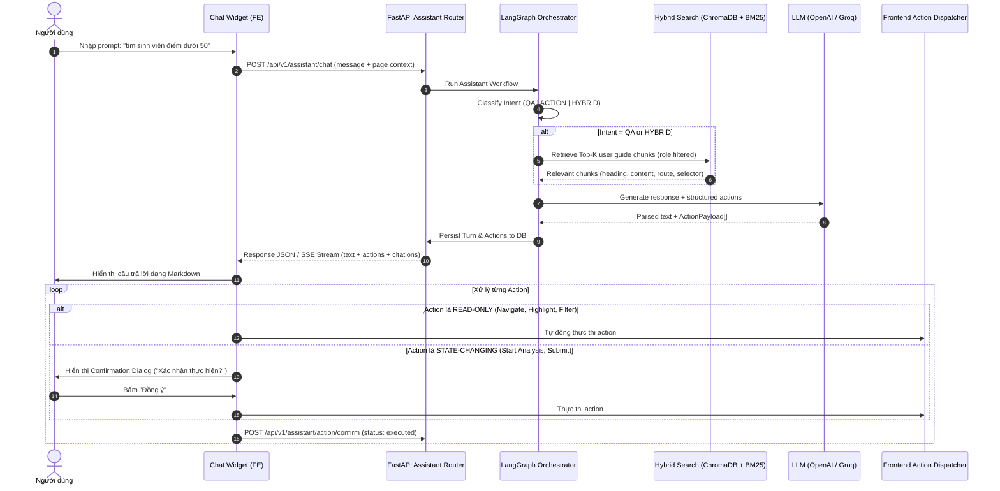
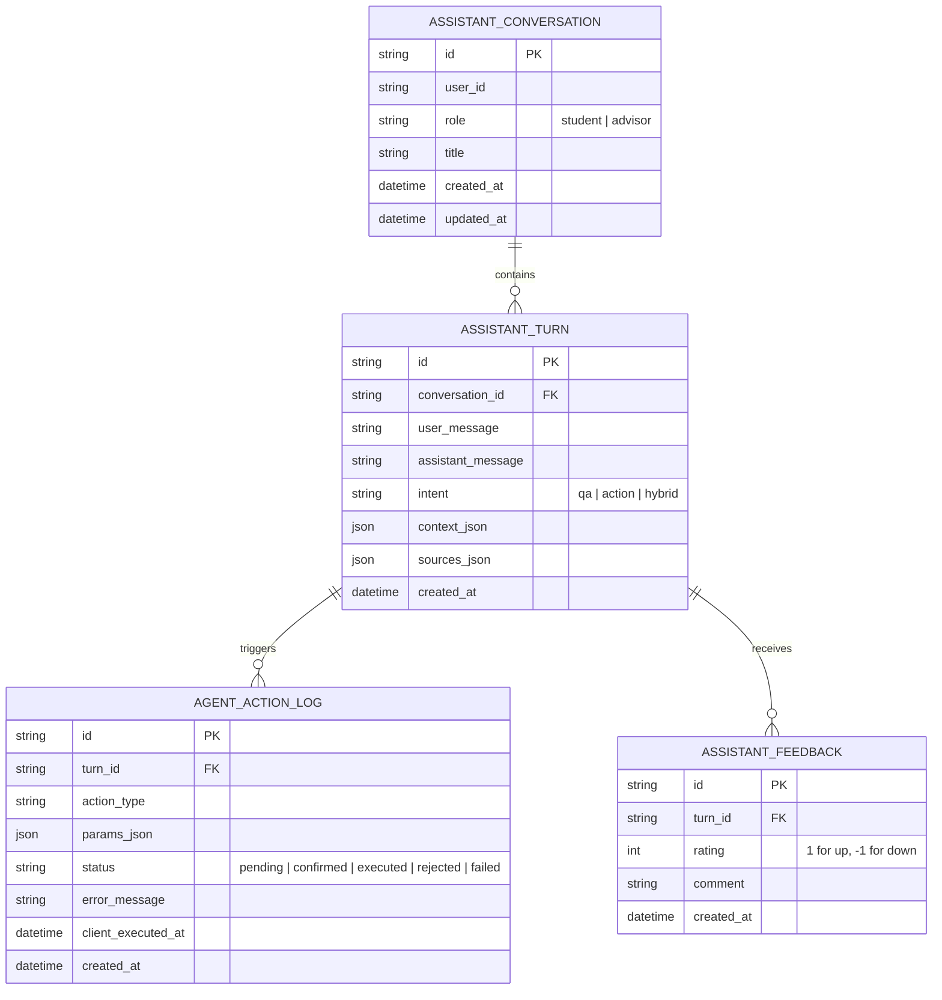

# SPEC-00: PRD, Architecture & UI Action Protocol Contract

## 1. Executive Summary & Product Requirements (PRD)

### 1.1 Mục tiêu tính năng (Feature Objective)
Xây dựng hệ thống **Smart Assistant (RAG Chatbot + UI Automation Agent)** tích hợp trực tiếp vào web app EDU-17 ("Trợ lý nghề nghiệp X"). Hệ thống giải quyết 2 bài toán cốt lõi:
1. **Chế độ Hướng dẫn (Informational Q&A / RAG):** Giải đáp tức thì mọi thắc mắc của người dùng về cách sử dụng web app: vị trí các nút bấm, ý nghĩa các chỉ số (Match score, STAR rubric), luồng thao tác, quy trình phỏng vấn, khắc phục lỗi thường gặp. Kèm tính năng dẫn chứng và làm nổi bật trực tiếp (highlight) nút/thành phần trên màn hình người dùng.
2. **Chế độ Tự động hoá giao diện (UI Agent):** Khi người dùng ra lệnh bằng ngôn ngữ tự nhiên (prompt), trợ lý tự động phân tích ý định, sinh ra các lệnh điều khiển có cấu trúc (Action Protocol) để tương tác trực tiếp lên trang: tự chuyển trang, tự lọc danh sách ứng viên/lịch sử, mở modal tải CV, kích hoạt phỏng vấn thử hoặc phân tích khoảng cách kỹ năng.

### 1.2 Persona & Phân quyền (Role-Aware Context)
Web app phục vụ 2 nhóm người dùng với các quyền hạn và giao diện khác nhau:
- **Sinh viên (Student):**
  - Phạm vi trang: `/student/overview`, `/student/cv`, `/student/analysis`, `/student/interview`, `/student/history`, `/student/share`, `/student/settings`.
  - Nhu cầu: Tìm nút nộp CV, hướng dẫn phỏng vấn STAR, cách cải thiện match score, tự động mở chi tiết bài phỏng vấn gần nhất.
- **Cố vấn học tập (Advisor):**
  - Phạm vi trang: `/advisor/dashboard`, `/advisor/students`, `/advisor/reviews`, `/advisor/analytics`, `/advisor/settings`.
  - Nhu cầu: Lọc danh sách sinh viên có nguy cơ (at-risk), xem phản hồi CV cần duyệt, chuyển nhanh đến hồ sơ sinh viên cụ thể.

---

## 2. Luồng dữ liệu & Giao thức Ngữ cảnh (Context Protocol)

### 2.1 Client Context Payload (Gửi kèm mỗi tin nhắn)
Mỗi request chat từ Frontend gửi lên Backend sẽ đính kèm ngữ cảnh thời gian thực của giao diện hiện tại:

```json
{
  "message": "mở chi tiết buổi phỏng vấn backend tối qua",
  "conversation_id": "conv-uuid-1234",
  "context": {
    "current_url": "/student/history",
    "route": "/student/history",
    "user_role": "student",
    "user_id": "std-001",
    "selected_cv_id": "cv-888",
    "page_state": {
      "active_tab": "interviews",
      "search_query": "",
      "visible_modals": []
    }
  }
}
```

### 2.2 Sơ đồ Kiến trúc & Luồng xử lý (Data Flow)



---

## 3. Bản hợp đồng Giao thức Hành động (UI Action Protocol Contract)

Hệ thống hỗ trợ 8 loại hành động giao diện chuẩn. Mỗi hành động tuân thủ cấu trúc JSON cố định:

```typescript
export interface AgentAction {
  id: string; // uuid
  action_type: 
    | "NAVIGATE_PAGE"
    | "HIGHLIGHT_ELEMENT"
    | "FILL_FILTER"
    | "OPEN_MODAL"
    | "START_ANALYSIS"
    | "SELECT_STUDENT"
    | "SCROLL_TO"
    | "RESET_VIEW";
  params: Record<string, any>;
  requires_confirmation: boolean;
  confirmation_message?: string;
  description_vi: string; // Mô tả ngắn gọn để hiển thị tooltip hoặc toast
}
```

### Chi tiết 8 Actions:

| Action Type | Ý nghĩa & Mô tả | Tham số (`params`) | Confirmation? | Ghi chú an toàn |
|---|---|---|---|---|
| `NAVIGATE_PAGE` | Chuyển trang trong Next.js App Router | `route: string` (e.g. `"/student/analysis"`), `query?: Record<string, string>` | `false` | Chỉ cho phép các route hợp lệ đã whitelist. |
| `HIGHLIGHT_ELEMENT` | Làm sáng một nút/thẻ trên UI với hiệu ứng spotlight/pulse | `selector: string` (e.g. `"[data-agent-target='btn-start-analysis']"` hoặc `#btn-upload`), `tooltip?: string`, `duration_ms?: number` | `false` | Tự động cuộn đến element nếu nằm ngoài màn hình; tự tắt sau 5s nếu không click. |
| `FILL_FILTER` | Điền bộ lọc trên bảng dữ liệu hoặc form tìm kiếm | `filter_name: string` (e.g. `"status"`, `"keyword"`), `value: string \| number` | `false` | Kích hoạt event cập nhật state của bộ lọc. |
| `OPEN_MODAL` | Mở một hộp thoại (modal / drawer) | `modal_id: string` (e.g. `"upload-cv-modal"`, `"feedback-modal"`) | `false` | Mở component modal tương ứng theo ID. |
| `START_ANALYSIS` | Kích hoạt tác vụ phân tích CV - JD | `cv_id: string`, `jd_id: string` | **`true`** | **Bắt buộc xác nhận**: "Bạn có muốn bắt đầu phân tích CV cho vị trí này?". |
| `SELECT_STUDENT` | Chọn một sinh viên cụ thể trong danh sách cố vấn | `student_id: string` | `false` | Dành cho role `advisor`. |
| `SCROLL_TO` | Cuộn trang đến phần tử hoặc vị trí chỉ định | `selector?: string`, `position?: "top" \| "bottom"` | `false` | Smooth scrolling behavior. |
| `RESET_VIEW` | Đặt lại toàn bộ bộ lọc hoặc đóng các modal đang mở | `clear_filters?: boolean`, `close_modals?: boolean` | `false` | Khôi phục trạng thái mặc định của trang. |

---

## 4. Đặc tả Cơ sở dữ liệu (Database Schema)

Hệ thống lưu trữ lịch sử hội thoại và nhật ký hành động trong SQLite (`data/app.db`) qua SQLAlchemy ORM:



---

## 5. Security, Guardrails & Error Handling

1. **Role Gating:** Trợ lý không bao giờ sinh ra action thuộc trang của `advisor` nếu `user_role` hiện tại là `student` (và ngược lại).
2. **Selector Whitelist / Sanitization:** Không cho phép LLM chèn mã JavaScript tuỳ ý (`eval`, `script`, `onclick`). Mọi thao tác DOM đều kích hoạt thông qua danh mục Action Types định nghĩa trước.
3. **Graceful Fallback:** Nếu vector search không tìm thấy tài liệu phù hợp (similarity score < threshold 0.35), trả về câu trả lời hướng dẫn tổng quát và gợi ý người dùng các trang tính năng chính kèm action `NAVIGATE_PAGE`.
4. **Action Timeout & Failure Handling:** Nếu selector không tồn tại trên trang (do user đã đóng modal hoặc đổi trang), Action Dispatcher ghi nhận status `"failed"` và báo nhẹ nhàng qua Toast thay vì làm đơ ứng dụng.
