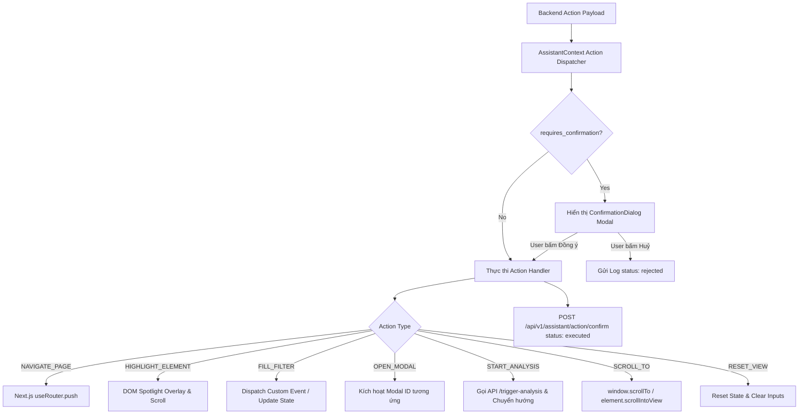

# SPEC-03: Day 3 — UI Agent Action Execution, Spotlight & Safety Confirmation

> **Mục tiêu Ngày 3:** Hoàn thiện toàn bộ năng lực tự động hoá giao diện (UI Agent). Trợ lý có thể highlight trực quan các thành phần DOM, điều khiển form/filter, mở modal, điều hướng mượt mà, và hiển thị hộp thoại xác nhận (Human-in-the-Loop Confirmation) đối với các hành động quan trọng trước khi thực thi.

---

## 1. Kiến trúc Action Dispatcher & DOM Bridge

Frontend cần một hệ thống lắng nghe và thực thi các lệnh trong Action Protocol một cách an toàn và không phụ thuộc chặt vào cấu trúc HTML cụ thể:



---

## Task 3.1: DOM Highlighter & Spotlight Overlay

### File: `frontend/components/assistant/element-highlighter.tsx`
Component này quản lý hiệu ứng làm nổi bật thành phần giao diện khi nhận action `HIGHLIGHT_ELEMENT`:
- **Tìm kiếm phần tử:** Tìm phần tử theo `selector` (ưu tiên `[data-agent-target="..."]`, fallback sang ID `#...` hoặc class).
- **Smooth Scroll:** Nếu phần tử nằm ngoài màn hình hiển thị (viewport), tự động cuộn màn hình tới phần tử với `scrollIntoView({ behavior: 'smooth', block: 'center' })`.
- **Spotlight Effect:**
  - Tạo một bounding box bao quanh phần tử với hiệu ứng viền gradient phát sáng (pulse animation).
  - Thêm một badge/tooltip nhỏ bên cạnh giải thích: "🎯 Trợ lý đang chỉ vào đây".
  - Tự động huỷ highlight sau thời gian `duration_ms` (mặc định 5 giây) hoặc khi người dùng click vào phần tử.

```tsx
// frontend/components/assistant/element-highlighter.tsx
'use client';

import React, { useEffect, useState } from 'react';

interface HighlightState {
  rect: DOMRect | null;
  tooltip?: string;
}

export function ElementHighlighter({ selector, tooltip, durationMs = 5000, onDismiss }: {
  selector: string | null;
  tooltip?: string;
  durationMs?: number;
  onDismiss: () => void;
}) {
  const [highlight, setHighlight] = useState<HighlightState | null>(null);

  useEffect(() => {
    if (!selector) {
      setHighlight(null);
      return;
    }

    const el = document.querySelector(selector);
    if (!el) {
      console.warn(`[Agent] Element not found for selector: ${selector}`);
      onDismiss();
      return;
    }

    el.scrollIntoView({ behavior: 'smooth', block: 'center' });
    const updateRect = () => {
      const rect = el.getBoundingClientRect();
      setHighlight({ rect, tooltip });
    };

    updateRect();
    window.addEventListener('resize', updateRect);
    window.addEventListener('scroll', updateRect);

    const timer = setTimeout(() => {
      onDismiss();
    }, durationMs);

    return () => {
      window.removeEventListener('resize', updateRect);
      window.removeEventListener('scroll', updateRect);
      clearTimeout(timer);
    };
  }, [selector, tooltip, durationMs, onDismiss]);

  if (!highlight?.rect) return null;

  return (
    <div className="fixed inset-0 pointer-events-none z-50 transition-all duration-300">
      <div
        className="absolute rounded-lg border-2 border-blue-500 shadow-[0_0_20px_rgba(59,130,246,0.6)] animate-pulse"
        style={{
          top: `${highlight.rect.top + window.scrollY - 4}px`,
          left: `${highlight.rect.left + window.scrollX - 4}px`,
          width: `${highlight.rect.width + 8}px`,
          height: `${highlight.rect.height + 8}px`,
        }}
      >
        {highlight.tooltip && (
          <div className="absolute -top-9 left-0 bg-blue-600 text-white text-xs font-medium px-2 py-1 rounded shadow-md whitespace-nowrap">
            {highlight.tooltip}
          </div>
        )}
      </div>
    </div>
  );
}
```

---

## Task 3.2: Gắn Data Target Attributes vào các trang chính

Để đảm bảo UI Agent nhận diện và thao tác chính xác, thêm thuộc tính `data-agent-target` vào các nút bấm và vùng điều khiển quan trọng trong mã nguồn Next.js:

1. **Trang CV (`frontend/app/student/cv/page.tsx` hoặc component tương ứng):**
   - Nút Tải lên CV: `data-agent-target="btn-upload-cv"`
   - Danh sách CV đã tải: `data-agent-target="cv-list"`
2. **Trang Phân tích (`frontend/app/student/analysis/page.tsx`):**
   - Nút Bắt đầu phân tích: `data-agent-target="btn-start-analysis"`
   - Dropdown chọn CV: `data-agent-target="select-cv"`
   - Thẻ hiển thị Match Score: `data-agent-target="match-score-badge"`
3. **Trang Phỏng vấn (`frontend/app/student/interview/page.tsx`):**
   - Nút Bắt đầu phỏng vấn: `data-agent-target="btn-start-interview"`
4. **Trang Lịch sử (`frontend/app/student/history/page.tsx`):**
   - Bộ lọc tìm kiếm: `data-agent-target="history-search-input"`
   - Danh sách phiên: `data-agent-target="history-session-list"`

---

## Task 3.3: Action Confirmation Modal (Human-in-the-Loop)

### File: `frontend/components/assistant/action-confirmation-dialog.tsx`
Khi nhận được một action có `requires_confirmation: true` (ví dụ: `START_ANALYSIS`), hiển thị hộp thoại cảnh báo người dùng:

- **Tiêu đề:** "Yêu cầu xác nhận hành động"
- **Nội dung:** Hiển thị `confirmation_message` hoặc `description_vi` (Ví dụ: *"Trợ lý muốn bắt đầu phân tích khoảng cách kỹ năng giữa CV của bạn và JD Backend Developer. Bạn có đồng ý thực hiện?"*).
- **Nút hành động:**
  - Nút "Huỷ bỏ": Đóng dialog, gửi trạng thái `rejected` về backend.
  - Nút "Đồng ý thực hiện": Kích hoạt handler thực thi action, gửi trạng thái `executed` về backend.

---

## Task 3.4: Action Dispatcher Hoàn chỉnh

### File: `frontend/lib/action-dispatcher.ts`
Hiện thực hoá hàm điều phối `dispatchAgentAction`:
```typescript
import { AppRouterInstance } from "next/dist/shared/lib/app-router-context.shared-runtime";
import { AgentAction } from "@/types/assistant";
import { toast } from "sonner";
import { confirmAction } from "./assistant-api";

export async function executeAgentAction(
  action: AgentAction,
  router: AppRouterInstance,
  setHighlightSelector: (selector: string | null, tooltip?: string) => void
) {
  try {
    switch (action.action_type) {
      case "NAVIGATE_PAGE": {
        const targetRoute = action.params.route;
        if (targetRoute) {
          toast.info(`Đang chuyển hướng tới ${action.description_vi || targetRoute}`);
          router.push(targetRoute);
        }
        break;
      }

      case "HIGHLIGHT_ELEMENT": {
        const selector = action.params.selector;
        if (selector) {
          setHighlightSelector(selector, action.params.tooltip || action.description_vi);
        }
        break;
      }

      case "FILL_FILTER": {
        // Dispatch Custom Event để page component lắng nghe
        window.dispatchEvent(
          new CustomEvent("agent:fill_filter", {
            detail: { filter_name: action.params.filter_name, value: action.params.value },
          })
        );
        toast.success(`Đã cập nhật bộ lọc: ${action.params.filter_name}`);
        break;
      }

      case "SCROLL_TO": {
        if (action.params.position === "top") {
          window.scrollTo({ top: 0, behavior: "smooth" });
        } else if (action.params.position === "bottom") {
          window.scrollTo({ top: document.body.scrollHeight, behavior: "smooth" });
        } else if (action.params.selector) {
          const el = document.querySelector(action.params.selector);
          el?.scrollIntoView({ behavior: "smooth", block: "center" });
        }
        break;
      }

      case "OPEN_MODAL": {
        window.dispatchEvent(
          new CustomEvent("agent:open_modal", {
            detail: { modal_id: action.params.modal_id },
          })
        );
        break;
      }

      case "RESET_VIEW": {
        window.dispatchEvent(new CustomEvent("agent:reset_view"));
        toast.info("Đã khôi phục trạng thái xem mặc định");
        break;
      }

      default:
        console.log(`Action type ${action.action_type} executed`);
    }

    // Báo cáo hoàn tất về backend
    await confirmAction(action.id, "executed");
  } catch (err: any) {
    console.error(`Failed to execute action ${action.id}:`, err);
    await confirmAction(action.id, "failed");
    toast.error("Không thể thực hiện hành động tự động");
  }
}
```

---

## Task 3.5: Kiểm thử Toàn diện E2E & Kịch bản Demo (DoD Ngày 3)

### Kịch bản 1: Hỏi đáp vị trí nút kèm Highlight
1. Sinh viên ở trang `/student/overview`.
2. Mở chatbot, nhập prompt: `"Nút bắt đầu phân tích CV nằm ở đâu?"`
3. **Kết quả mong đợi:**
   - Trợ lý trả lời giải thích trang và sinh 2 actions: `NAVIGATE_PAGE` sang `/student/analysis` và `HIGHLIGHT_ELEMENT` trỏ vào `[data-agent-target="btn-start-analysis"]`.
   - Trang tự chuyển và nút phân tích sáng viền xanh nhấp nháy kèm tooltip.

### Kịch bản 2: Lệnh tự động có xác nhận an toàn (HITL)
1. Sinh viên nhập prompt: `"Hãy bắt đầu phân tích CV mới nhất của tôi với JD Backend"`
2. **Kết quả mong đợi:**
   - Trợ lý phản hồi: "Tôi đã chuẩn bị phiên phân tích CV cho vị trí Backend. Vui lòng xác nhận để bắt đầu."
   - Hộp thoại Confirmation Dialog xuất hiện trên màn hình.
   - Khi bấm "Đồng ý", hệ thống bắt đầu quy trình phân tích.

### Kịch bản 3: Lọc danh sách lịch sử bằng giọng lệnh tự nhiên
1. Sinh viên ở trang `/student/history`.
2. Nhập prompt: `"Lọc các phiên phỏng vấn mock interview"`
3. **Kết quả mong đợi:**
   - Trường tìm kiếm / filter tab tự động đổi sang "Mock Interview".
